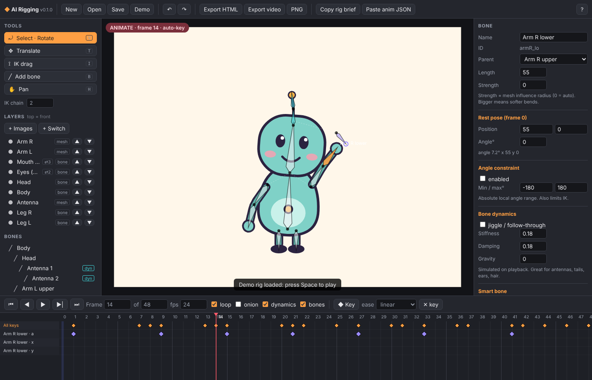

# AI Rigging

**Moho-style 2D cutout rigging that runs in the browser and exports to plain HTML.**
Bones, IK, mesh-bending images, switch layers, smart bones, bone dynamics and a keyframe timeline, in one dependency-free page. Your rig and animation live in a readable JSON file that people and AI assistants can both write.



## Why

Moho, Harmony and Spine are great, but their rigs stay inside their apps (or need a paid runtime license). AI Rigging is a small open tool for the web:

- **Rig and animate in the browser.** Open `index.html`. No install, no build step, no server.
- **Ship as HTML.** Export a single self-contained `.html` player with the art embedded, ready to drop on a site.
- **AI friendly.** The format is plain JSON with named bones and `[frame, value, ease]` keys. Copy a rig brief, paste it into Claude, describe the shot, paste the JSON reply back.

## Quick start

1. Open `index.html` in Chrome, Edge, Firefox or Safari (double-click works), or enable GitHub Pages on this repo and use the hosted URL.
2. The **Pip** demo rig loads. Press **Space** to play.
3. Drag a bone to rotate it. On frame 1+ every change auto-keys.

## Features (v0.1)

| Moho idea | AI Rigging | Notes |
|---|---|---|
| Frame 0 setup mode | Yes | Frame 0 is the rest pose. Moving bones there changes the rig, not the animation, and does not drag bound art. |
| Bones and FK | Yes | Hierarchy, length, rest position and angle, re-parenting that keeps the world pose. |
| Manipulate bones (IK) | Yes | CCD IK drag with adjustable chain length, respects angle constraints. Writes normal FK keys. |
| Layer binding | Yes | "Rigid" mode: an image follows one bone. |
| Smart Warp / region binding | Yes | "Mesh" mode: an image is a grid mesh skinned to several bones by distance and bone strength, so arms, tails and antennas bend smoothly. |
| Switch layers | Yes | Any layer with more than one drawing. Mouths, eyes, hands, head turns. Stepped keys. |
| Smart bones | Yes | Mark a bone as a dial, press **Edit action**, set the dial value and pose. Rotating the dial replays corrective poses and drawing swaps. |
| Bone constraints | Yes | Min and max local angle. |
| Bone dynamics | Yes | Spring follow-through for antennas, tails, ears and hair, simulated on playback. |
| Squash and stretch | Yes | `sx` / `sy` scale channels per bone. |
| Timeline | Yes | Per-channel tracks, summary row, drag keys, onion skin, loop, eases: linear, smooth, ease-in, ease-out, fast-out, overshoot, anticipate, step, or a custom cubic bezier. |
| Export | Yes | Project JSON, standalone HTML player, WebM video, PNG frame. |

## Workflow

1. **Frame 0, import art.** `+ Images` adds one layer per file (PNG, SVG, JPG, WebP), or drag files onto the stage. `+ Switch` makes one switch layer from several files. Draw hidden areas in full under overlaps so joints do not gap.
2. **Add bones.** Press **B**, drag from the joint to the tip. A new bone becomes a child of the selected bone. Put pivots at the centre of each joint.
3. **Bind.** Select a layer, pick its bone in the inspector. Use **Mesh** for parts that should bend and tick the bones that influence it.
4. **Animate.** Go to frame 1+. Pose with **V** (rotate), **T** (translate) or **I** (IK). Every change keys the current frame. Pick drawings in the inspector to key switch layers. Select keys in the timeline to change eases or drag them in time.
5. **Smart bones.** Select a bone, tick *this bone is a dial*, press *Edit action*. Scrub the dial in the timeline, pose other bones or pick drawings. Back in the animation, keying the dial bone's angle plays the action.
6. **Export.** *Export HTML* for the web, *Export video* for a WebM, *Save* for the project JSON.

### Shortcuts

`V` select/rotate, `T` translate, `I` IK, `B` add bone, `H` pan (or Alt/middle-drag), wheel zoom, `F` fit, `Space` play, `,` `.` step frames, `Home` `End`, `K` key selection, `Delete` delete key/bone/layer, `O` onion, `Ctrl+Z` / `Ctrl+Shift+Z` undo/redo, `Ctrl+S` save.

## Animating with an AI assistant

1. Click **Copy rig brief**. It lists every bone, layer, drawing, smart bone, the channels and the exact JSON shape to reply with.
2. Paste it into Claude with a shot description, for example: *"Pip notices something off screen, does a small take, then waves twice and laughs. 3 seconds."*
3. Click **Paste anim JSON**, paste the reply, choose **Merge** or **Replace**.

The brief already asks for good cutout habits: breakdowns, child parts offset 1 to 3 frames behind parents, and staggered stops.

## Embedding a rig in your own page

```html
<canvas id="pip"></canvas>
<script src="src/engine.js"></script>
<script>
  fetch('examples/pip-demo.rig.json').then(r => r.json()).then(project => {
    new RigKit.Player(document.getElementById('pip'), project, { loop: true, autoplay: true });
  });
</script>
```

The engine (`src/engine.js`) has no dependencies. `RigKit.evaluate(project, frame)` gives you the pose and `RigKit.render(ctx, project, pose, images)` draws it, if you want to drive it yourself (scroll-linked animation, game state, lip sync from audio).

## File format

See [docs/FORMAT.md](docs/FORMAT.md). The short version: bones with rest transforms, layers with drawings and a binding, and `anim` / `actions` stores of `[frame, value, ease]` keys per channel.

## Project layout

```
index.html            editor
css/editor.css
src/engine.js         runtime: math, FK, smart bones, dynamics, mesh skinning, renderer, Player
src/editor.js         editor UI
src/demo.js           the Pip demo rig (SVG art, no binary assets)
examples/             sample project JSON
docs/FORMAT.md        file format reference
```

## Roadmap ideas

- Vector (SVG path) point binding, like Moho vector layers
- Two-bone analytic IK with pole direction, IK targets and pin bones
- Graph editor for curves
- Multi-directional smart bones (2D dials)
- Hand-painted mesh weights and custom mesh shapes
- Lip sync from audio (phoneme to switch layer keys)
- Lottie and Spine JSON export, PNG sequence and GIF export
- Bone flip and view (front, 3/4, profile) systems

## License

MIT. See [LICENSE](LICENSE).
