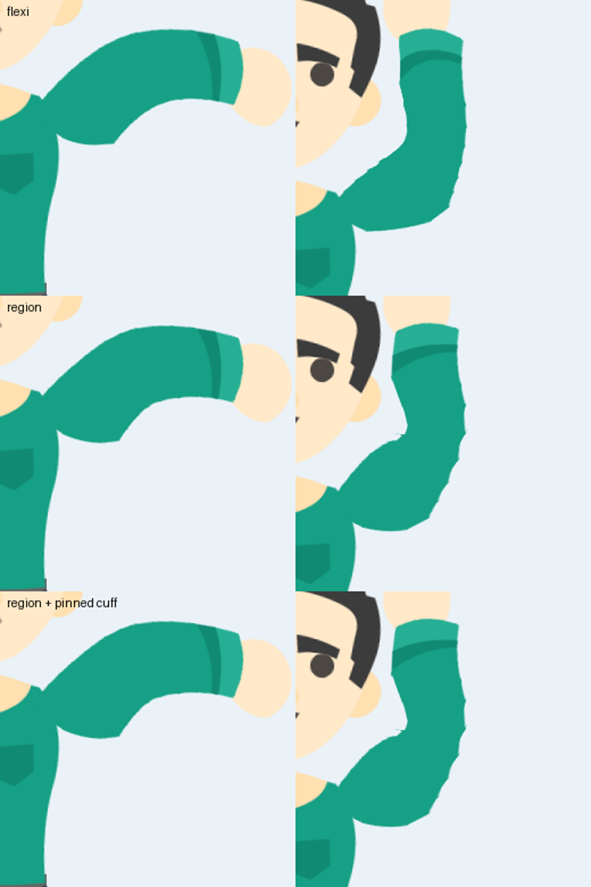

# Binding art to bones (Moho-style)

How AI Rigging attaches drawings to bones, mapped to the binding methods Moho riggers use. Study source: McCoy Buck, "Best Binding Method for Moho Rigs?" (https://youtu.be/iPJAk5Afqk0), plus the Moho manual and Lost Marble forum notes listed at the end.

*Same Kenney sleeve, same poses (F17, F28). Flexi gives a round, soft elbow. Region gives a crisper elbow that reads as two solid segments. Pinning the cuff keeps the cuff band rigid while the forearm bends.*

## The methods

| Moho method | AI Rigging | What it does | Use it for |
|---|---|---|---|
| **Layer binding** | Mode **Layer binding (rigid)** | The whole drawing follows one bone. No deformation. | Heads, hands, eyes, mouths, props: anything that never bends. Bind a **group** once and every part inside follows. |
| **Flexi-binding** | Mode **Flexi-binding (smooth bend)** | Every listed bone pulls every vertex of the image mesh, weaker with distance. With no bones ticked it uses all bones, like Moho's default. | Sleeves, tails, hair, soft bodies. Tick only the nearby bones, the same as Moho's *Use Selected Bones for Flexi-Binding*. |
| **Region binding** + **Bone Strength** | Mode **Region binding (bone strength)** + tool **S** | Each bone has a radius (its strength). Inside it the bone has influence; vertices outside every region follow the closest bone. | Limbs that should bend cleanly at the joint without far bones tugging the art. |
| **Point binding** | Tool **P** (Point Bind brush) on a flexi or region layer | Chosen vertices move rigidly with one bone and ignore the automatic weights. | Keeping cuffs, hands, shoe soles or a belt buckle from warping; fixing a stray tug on a few vertices. |
| Combination | Any mix per layer | Moho riggers combine methods in one character. | The normal case: rigid head and hands, region or flexi limbs, a few pinned vertices. |

## The flexi pitfall

With flexi-binding, a bone influences art far away from it, so moving an arm can make a toe twitch. Moho's fixes: switch to region binding, lower bone strength, or limit each layer to selected bones. In AI Rigging, flexi layers start with only their own bone and its children ticked. An empty list means all bones, so tick bones deliberately.

## Bone Strength tool (S)

- Shows each bone's strength as a capsule. With a flexi or region layer selected, only that layer's bones are shown.
- Drag outward or inward on a capsule to set the radius. Rig data, so set it on frame 0.
- Region mode uses it as a hard cutoff. Flexi mode uses it as the falloff scale (bigger = that bone dominates a wider area).

## Point Bind brush (P)

1. Select a layer bound with flexi or region.
2. In the inspector under **Point binding**, pick the bone to pin to and the brush size. `[` and `]` change the size too.
3. Press **P** and paint over the mesh dots. Pinned vertices show in the bone's colour. **Shift**+paint releases them.

## Choosing, the short version

1. Does the part bend? No: **layer binding**. Bind the group if it is a part stack.
2. Yes, and it should look soft and rubbery: **flexi**, tick only neighbouring bones.
3. Yes, and it should look like a limb with a clean joint: **region**, set strengths so the regions just overlap at the joint.
4. Something small warps that should not: **point bind** those vertices.

## Sources

- McCoy Buck, "Best Binding Method for Moho Rigs?", https://youtu.be/iPJAk5Afqk0
- Moho manual, Tutorial 3.1 (automatic binding, region binding, bone strength): https://www.lostmarble.com/moho/manual/tut03/01
- Lost Marble forum, binding types: https://www.lostmarble.com/forum/viewtopic.php?p=27624
- Lost Marble forum, layer binding a group: https://www.lostmarble.com/forum/viewtopic.php?p=186879
- Lost Marble forum, flexi-binding on image layers uses a hidden mesh: https://lostmarble.com/forum/viewtopic.php?p=215221
- Lost Marble forum, Use Selected Bones for Flexi-Binding: https://www.lostmarble.com/forum/viewtopic.php?p=212684
