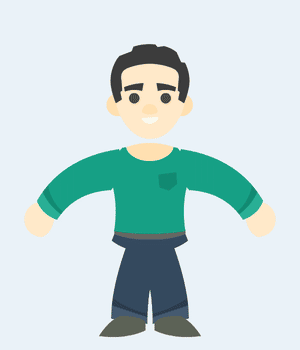

# Review 01: first real-asset test (Kenney Modular Characters)

Test: rig a character from someone else's art (not drawn for this tool), animate a 3 second shot, then review it like a director and an animation supervisor would in dailies.

## Asset

- **Kenney, "Modular Characters"** (425 flat vector parts, CC0 1.0, made for Spine and Spriter rigs). Source: https://kenney.nl/assets/modular-characters [VERIFIED: licence file in the pack]
- Parts used: head, neck, hand, pine shirt and long sleeve, navy pants top and long trouser, black shoe, black hair, eyes, brows, nose, 3 mouths.
- Kenney ships one arm, one trouser and one shoe drawing. The other side must be mirrored. That alone exposed the first missing feature (layer flip).

Rebuild: `python3 examples/build_kenney_guy.py <path>/modularcharacters/PNG examples/kenney-guy.rig.json`

## Shot

**Acting objective:** he spots a friend off-screen right, lights up, waves big, then settles back still grinning. 72 frames at 24 fps, looping.

| Frames | Beat | Notes |
|---|---|---|
| 1 to 9 | Neutral | Hold, nothing moving. |
| 9 to 12 | Notice | Brows pop up, mouth "oh", eyes dart right, head tips toward the friend. Thought leads (eyes first, then the head 2f later). |
| 12 to 15 | Anticipation | Spine squashes (sx 0.965), arm drops and pulls back 10 degrees. |
| 15 to 21 | Arm up | Overshoot ease on the upper arm. Forearm +2f, hand +3f. Mouth swaps to "glad". |
| 21 to 54 | Wave | Forearm oscillates every 6f, hand flicks opposite 2f late. Blink at 44 to 47 (eyes bone sy 0.12, 2 frames). |
| 54 to 66 | Arm down | Upper arm leads, forearm stays bent (drag) until F58, unfolds with overshoot at F64. |
| 66 to 73 | Settle | Back to frame 1 for a clean loop. |

## Dailies: v1 notes and what changed

| # | Frames | Note | Priority | Fix |
|---|---|---|---|---|
| 1 | Rest | Trousers and shoes mirrored on the wrong side: legs pinch into a skirt and the toes point inward. | Must | Swapped the flips. |
| 2 | Rest | A background-coloured gap between the neck and the collar. | Must | Neck moved down 16 px under the collar. |
| 3 | All | Hairline seams across the sleeves and trousers. **Engine bug:** clip anti-aliasing between mesh triangles. | Must | Each triangle's edges now grow 0.9 screen px from the incenter, not the centroid. Thin triangles are covered too. |
| 4 | 21 to 52 | Reads as scratching his head, not waving. The forearm folds over the head and the hand disappears behind the hair. The silhouette loses the hand. | Must | Upper arm -76 instead of -100, forearm held vertical, wave range kept out to screen right. |
| 5 | 17 to 24 | A gap opens at the shoulder once the sleeve passes about 90 degrees. | Must | Waving arm moved in front of the shirt (z-order). |
| 6 | 59 | Both arms pass through the same flat T-pose. Twinning, and no drag. The left arm's sway was going up, not down. | Should | Forearm drags on the way down; left arm sway reversed and reduced. |
| 7 | 9 to 54 | Waving to someone on the right while staring into the camera. | Should | Eyes bone x +6 (eye dart) for the whole wave. |
| 8 | 17, 28 | Elbow fold: a sliver of sleeve folds over on the inner side (linear blend skinning collapse). | Should | New per-layer `mesh.falloff` (default 2.5, was a hard-coded 4) and denser arm mesh. Tested 4 / 2.5 / 1.8: 2.5 kills the fold without thinning the wrist. |

## Tool changes shipped from this review

- **Layer flip** (`flipX`, `flipY`): reuse one limb drawing for both sides.
- **Seam-free mesh rendering** (incenter edge growth).
- **Mesh weight falloff** per layer, in the inspector.
- **Keyable z order** (`z` layer channel, stepped): an arm can cross in front of the body for part of a shot.

## Director and animator inputs for the next versions

Ranked by what blocks real shots first.

1. **Foot lock (IK targets / pin bones).** Must. In this shot the hips could not move at all: the feet are children of the hips, so any weight shift slides the shoes. Every walk, sit, crouch or weight shift needs feet that stay planted. Moho solves it with target bones and pinned bones, Harmony with IK constraints. [RECALLED] Proposal: an `ik` block per chain (`{chain:[legL_up, legL_lo], target:"footL_target", bend:+1}`), a two-bone analytic solver at runtime, and a "pin" toggle in the editor that creates and keys the target.
2. **Corrective shapes on joints (smart bone on the elbow itself).** Should. Even at falloff 2.5 a 90 degree elbow is a soft tube. Cutout pros either swap a bent-arm drawing or drive a corrective shape from the elbow angle. Smart bones already exist, so the missing piece is letting an action move mesh vertices (point offsets), not just bones and drawings.
3. **View system for heads (front, 3/4, profile).** Should. A front-only head can't follow its own eyeline. Kenney has no turnarounds, so this needs a switch layer per view plus a smart bone ("head turn" dial) that swaps all face parts at once. The engine can do it today. The editor needs a one-click "make view set" helper.
4. **Graph editor and spacing view.** Should. Eases are presets per key. Supervisors judge spacing by its arcs and spacing charts. Add a curve view for the selected channel and motion trails (onion arcs) for selected bones.
5. **Lip sync from audio.** Could. Kenney gives 7 mouths, enough for a simple chart (A rest, O oh, E glad, teeth sets). Phoneme timing to `switch` keys, with mouths leading the sound by 1 to 2 frames.
6. **Hand library swaps.** Could. Kenney hands are mittens. A wave reads twice as well with an open palm and finger spread. Ask design for an open hand, a point and a fist per side (asset request, not code).
7. **Line boil / texture pass.** Could. Flat vector art looks sterile on twos. An optional SVG turbulence boil on export gives a hand-made feel.

## What is working (keep it)

- Frame 0 setup and auto-key on frame 1+ felt natural for posing.
- Mesh binding turned Kenney's single-piece curved sleeves and trousers into bendable limbs with no repainting.
- A smart bone on Pip and the switch-layer mouth here behaved exactly like their Moho counterparts.
- Squash and stretch via bone scale (spine squash, eye blink by scaling an eyes bone) covered drawings the pack does not include, like closed eyes.
